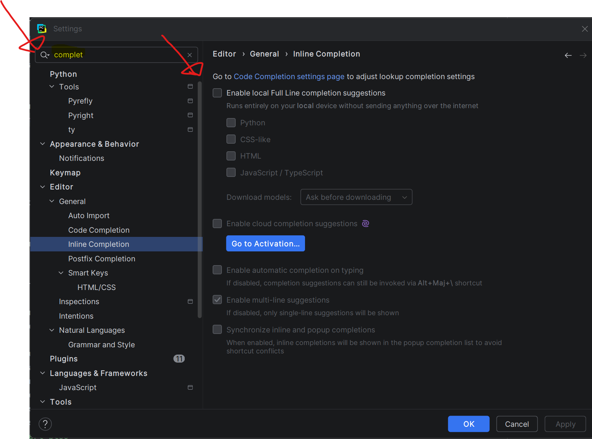

# Examen de Mi-Session partie pratique Automne 2026 gr002

# Instructions
- Inscrire votre nom et numéro de DA dans l'entête de chaque fichier
- Ne pas oublier de faire le "push" pour la remise (vous pouvez utiliser "commit and push" de PyCharm)
  - Si vous avez fait un ou plusieurs "commit" sans faire de "push", vous devez faire un "push" final avant l'heure limite de l'examen
  - Pour ce faire, aller dans `Git` > `Push...` dans PyCharm
- Le fait de faire des "commit and push" permet de remettre votre code au fur et à mesure

# Documentation
- Vous pouvez consulter la documentation officielle sur [python.org](https://docs.python.org/fr/3.14/library/)
  - https://docs.python.org/fr/3.15/builtins/stdtypes.html
- Vous avez accès au dépôt du cours sur github.com pour consulter les exemples vus en classe [420-SF1-RE-A26](https://github.com/plducharme/420-SF1-RE-A26)
- Vous avez aussi accès aux notes de cours dans LÉA.

# Interdictions
- Les IAs sont strictement interdites
- Le "Full inline completion" est interdit et doit être désactivé
  - 

